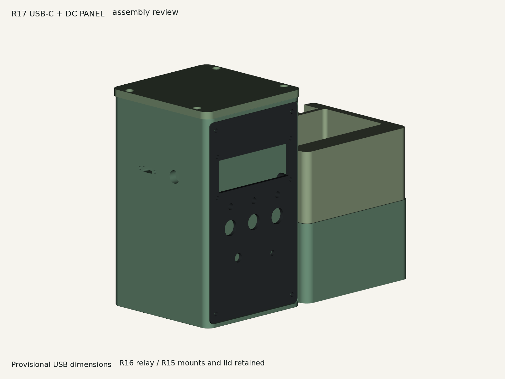
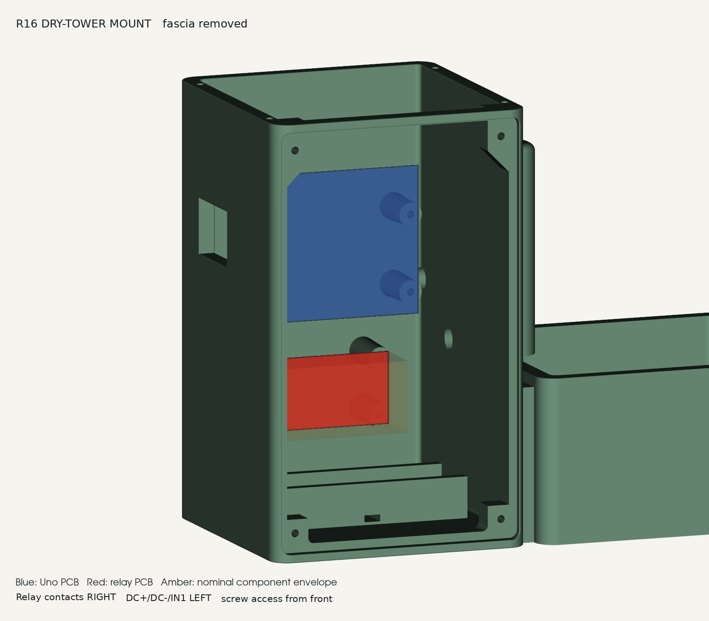
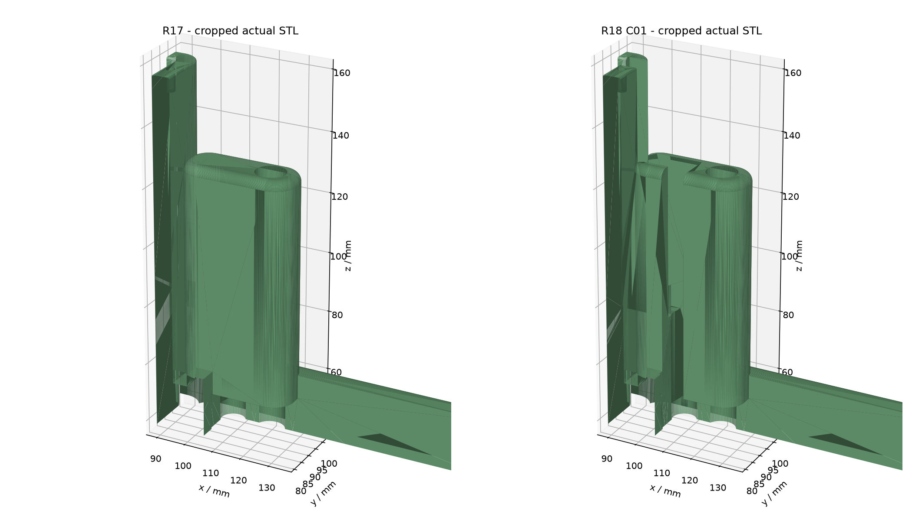
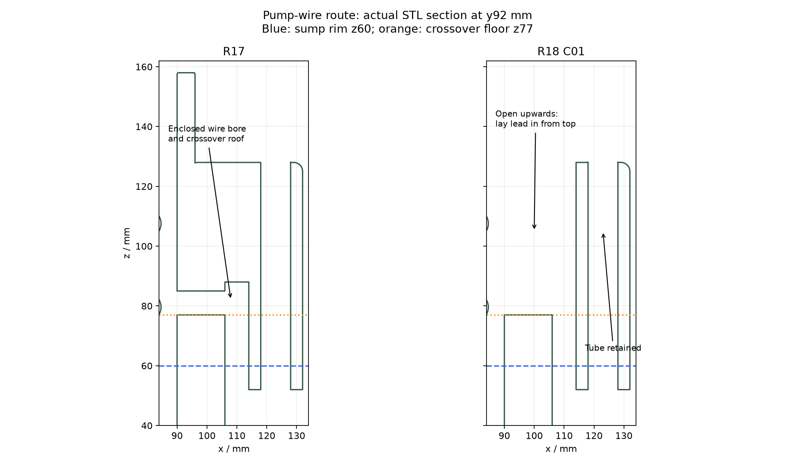
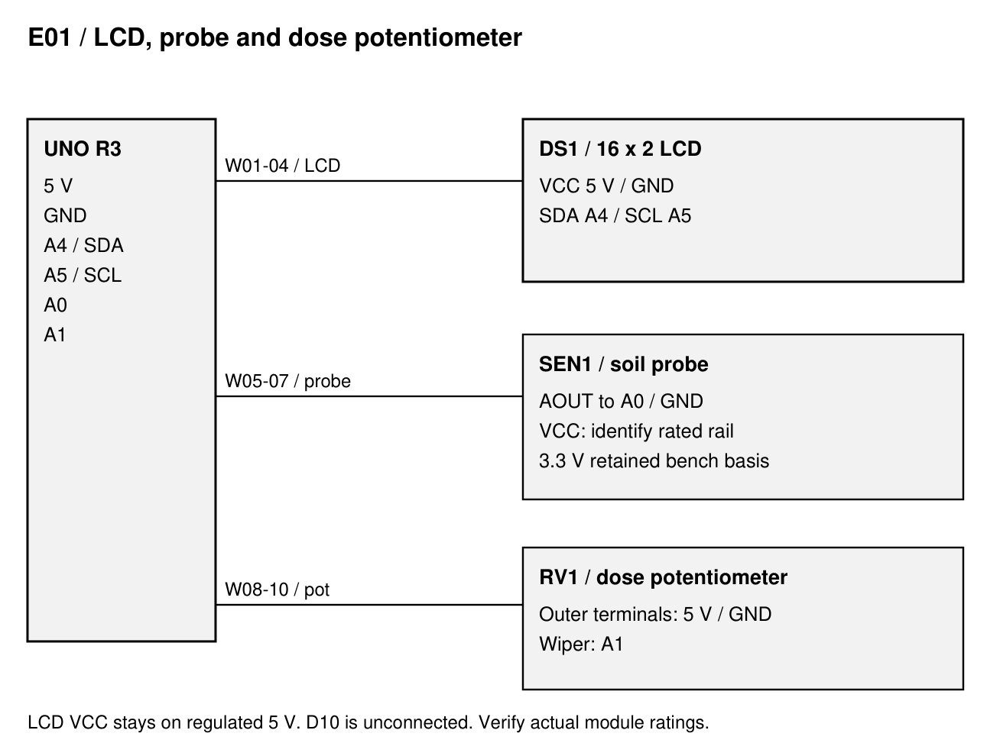
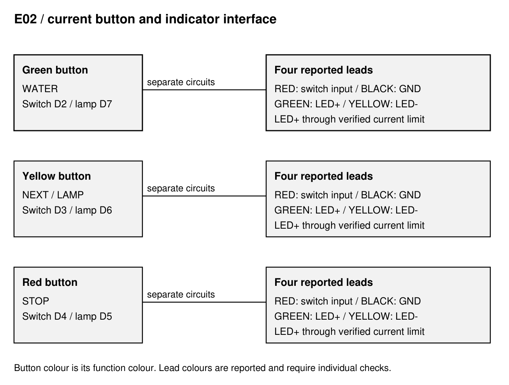
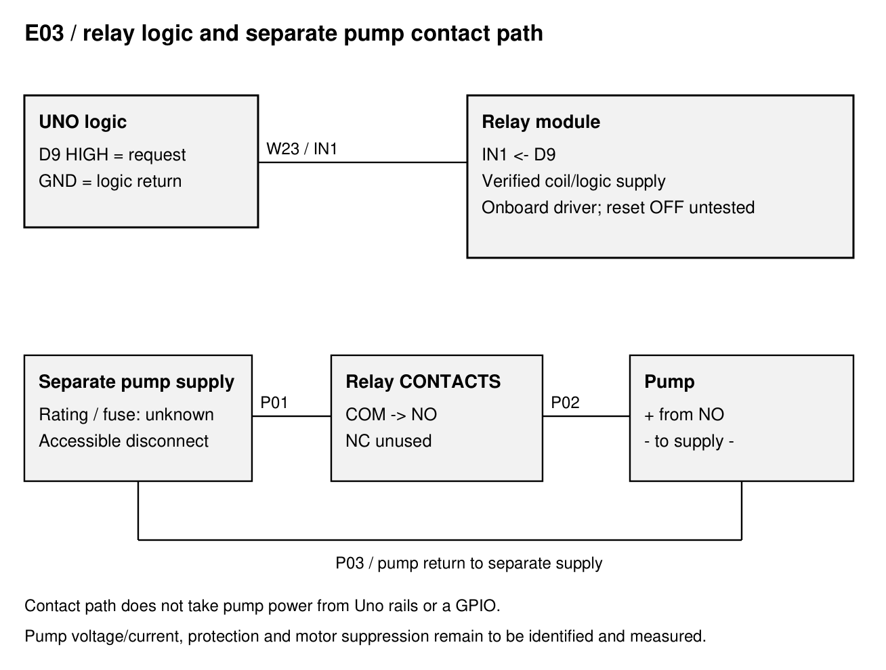
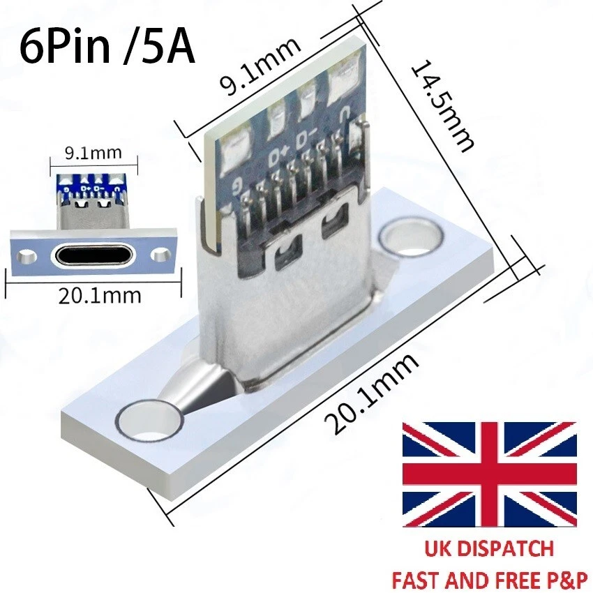

# Plant Station R18 - Assembly Manual
PLANT-AM-001 / R18 / D03 / 11 October 2026
Issued for combined prototype review; physical acceptance open

Current mechanical configuration: R18 open-route tower and R18 fascia with auxiliary holes closed; retained R16 lid (R15 geometry) and R13 planter. Electrical reference remains frozen Uno UI v6 and the 27 September interface record. Arduino/relay registration is Reported; physical retention, wiring, wet and operational acceptance remain open.

## Current status and configuration

Historical R17 assembled-STL review with the former enclosed route and R13 fascia apertures. It is retained for lineage and does not depict the combined R18 configuration or fitted hardware.

Use this integrated R18 D03 manual for the combined prototype: open pump-wire tower plus replacement fascia with four obsolete apertures closed. It succeeds R17 D02; R17 sources, issued documents and user print projects remain historical evidence.

Prototype status: digital geometry checks are recorded. Kevin reports that the newest tower accepts the Arduino and relay perfectly; this is partial board-registration evidence only. Screw retention, underside clearance, terminated-wire lay-in, closed fascia, full assembly, electrical and leak acceptance remain open.

Four main printed parts: tower_open_pump_route_r18, fascia_no_aux_apertures_r18, retained top_cover_flush_r16 and planter_sage. Select one measured-shaft knob variant. The optional route trial is a test artefact, not an additional assembly part.

Terms: Confirmed = retained current file/check evidence; Reported = operator/source observation; Inferred = analysis based on stated evidence; Assumed = explicit unmeasured geometry; Unknown = no adequate evidence; Not tested = no physical result. Uno UI v6 is unchanged by mechanical R18.

## Printed parts and exact file selection

| Part / qty | File | Use / disposition |
| --- | --- | --- |
| M01 / 1 | tower_open_pump_route_r18.stl | Combined R18 tower; 207 x 100 x 158 mm; STEP of same stem retained |
| M02 / 1 | fascia_no_aux_apertures_r18.stl | Replacement R18 fascia; 3 standalone LED holes and speaker hole closed; STEP retained |
| M03 / 1 | top_cover_flush_r16.stl | R15 lid geometry; 99 x 100 x 5.5 mm; assembled top z163.5 |
| M04 / 1 | planter_sage.stl (R13) | Retained removable planter and two drains |
| M05 / 1 | One measured-shaft knob variant | Choose from R13 knob variants, not all eight |
| T01 / first | power_ports_fit_coupon_r17.stl | 6 thick x 60 x 24; print and fit USB and DC hardware |
| T02 / first | boss_trial_pilot_2p8.stl (R15) | Full-depth screw trial; 3.0 alternative only after recorded failure |
| T03 / first | lid_head_trial_r15.stl | Actual lid screw-head and seating trial |
| T04 / optional | route_trial_r18.stl | 29 x 20 x 60 mm route corner: lay-in/local slicing trial only; full assembly still required |
| T05 / first | relay_mount_trial_r16.stl | Actual board, underside, screw and wire access trial |

Select the R18 tower and replacement fascia together with the retained lid and planter. R17 plate projects and sliced files are historical and are not R18 machine files. No accepted R18 slice or new physical print is recorded. Prior screw/lid/relay coupons remain relevant to their unchanged interfaces.

## Hardware, electronics and incoming evidence

| Item / qty | Specification basis | Evidence / action |
| --- | --- | --- |
| Uno / 1 | Classic Uno R3, ATmega328P | Reported newest-tower fit; record actual model, hole registration, underside and screw evidence |
| Uno screws / 4 | 2.8 x 11 blind pilot; screw dimensions unknown | Trial fastener family/length; do not force a fit |
| Relay / 1 + 4 screws | Nominal 50 x 26 PCB, 44.5 x 20.5 pitch, 3.1 holes | Reported newest-tower fit; actual underside, screw retention and wiring clearance remain open |
| Lid / 4 screws | 3.4 through holes; 6.6 x 2.5 head pockets | Head/type/length unknown; use lid coupon |
| Fascia / 4 screws | Retained 3.4 mm fixing holes and mating pilots | R18 fill leaves fixing geometry unchanged; actual fastener allocation remains provisional |
| LCD / 1 + 4 fixings | 16 x 2 I2C; 75 x 31 centres | Actual backpack/pin markings; M2.5 stack provisional |
| Buttons / 3 | Existing four-wire momentary buttons with integrated LEDs | All three button openings and lamp wiring retained; identify contacts, polarity and limiting |
| Potentiometer / 1 | A1 dose control; shaft/nut unknown | Verify terminals and select actual shaft-fit knob |
| USB-C / 1 + 2 screws | Image flange 20.1; PCB 9.1; depth 14.5 | Cut/pitch estimated; panel electrical interface open |
| DC extension / 1 | Requested 10 mm panel cut | Thread, nut, grip range, polarity and cable unknown |
| Pump / 1 + tubing | Separate supply reported 3.5 V | Rated voltage/current, envelope, outlet and tubing unverified |
| Probe / 1 | Installed 447 dry / 221 wet reference | Relative index; verify supply and installed probe |
| Standalone LEDs / sounder | Not fitted in current configuration | Former three 5 mm LED holes and 4 mm sound hole closed; blind rear seats retained; D10 unused |
| Holder / optional | Integrated insulated-holder saddle | Cell/charger/power path not accepted; leave cell out |

Use callipers, multimeter, hand drivers, small spanners and appropriate insulated harness tools. Printer, material, layer settings, fastener torque and instrument calibration status are Unknown until recorded. Do not use a powered driver for the printed pilot trials.

## Fit trials and print hold points

1. Print the R17 port coupon. Put its broad 60 x 24 face on the bed, with 6 mm thickness and hole axes vertical. Inspect the slicer orientation and record the resulting bore dimensions.

2. Fit USB-C and barrel hardware together: flange seats, mounting holes register, USB plug engages fully, DC nut/thread grip spans 6 mm, and both plug bodies and service leads clear. Stop on cracking, forcing or incomplete engagement.

3. Retain the 2.8 mm nominal Uno pilots. Trial actual screws in the R15 coupon where retention has not been evidenced; inspect splitting, bottoming, projection and board contact. Reported board fit does not qualify the screws or authorise a pilot change.

4. Trial the retained lid heads and relay screws; trial the pump and attached tube against the inherited lower relief. Use route_trial_r18 optionally for lay-in width and local print review. Check the actual terminated cable, bends and retention in the full R18 assembly; the coupon cannot establish those results.

Full-body print hold: resolve failed interfaces and review the actual R18 tower/fascia layers, orientation and supports for the intended printer/material. Candidate comparison slices are not accepted machine files. Correct affected geometry, rebuild and recheck before manufacture; retain the print job and part hashes.

## Uno and relay mounting; flush lid

Historical R16 nominal board-placement view. The mounting geometry is retained in R18; component proxies are approximate and this is not a fitted-hardware photograph.

Uno hole centres x/z: (79.75,107.56), (79.75,79.62), (28.95,122.80), (27.68,74.54). Seat plane y76; board faces the removable fascia. Register all four holes without bending the PCB.

Revised Uno bosses: 8.5 mm tip / 10.0 mm root, 19 mm projection, 2.8 mm blind pilot 11 mm deep from the seat. R18 retains this geometry with zero removed mounting-region volume. Kevin reports board fit; fastener engagement, retention, strength and actual underside clearance remain open.

Relay PCB x21-71 / z33-59, seat y76; contacts to the right, logic terminals left. Hole centres x/z: (23.75,35.75), (23.75,56.25), (68.25,35.75), (68.25,56.25). Bosses match the Uno cone/pilot profile. Check underside solder and actual wires before tightening.

Lid: 5.5 mm thick with 3.4 mm through holes and 6.6 mm diameter x 2.5 mm deep pockets. Nominal head bearing plane remains z161; top z163.5. Trial head height and engagement, then hand-seat all four screws without distortion.

## Wet-side pump, tube and sensor routes

Actual exported-mesh comparison: historical R17 enclosed pump-wire route and R18 front/top lay-in opening. Dimensions and physical acceptance limits are recorded below.

With every supply disconnected, remove the planter and fit the actual pump with its tube attached. Reserved pump envelope 38.5 x 25.5 x 43 mm is a reference, not a measured supplied part.

Retain the water tube through its 10 mm bore at x123/y92. With lid and planter removed and every supply disconnected, place the terminated pump leads in their respective wet/dry spaces, then lay the intermediate cable into the open front riser and lower it into the upward-open crossover. Do not push a terminal through the former enclosed bore.

R18 front channel: x106.5-114, y82-96, z52-129; nominal mouth 7.5 mm. Upward-open crossover: x89-114, y88-96, z77-159; nominal width 8 mm. Floor z77 remains 17 mm above the z60 sump rim. The lower pump/tube relief x106.5-132/y83-94/z4-52, sump floor, protected wet/dry partition, water bore and board mounts are preserved. These are CAD datums, not fill or strength acceptance.

Sensor entry is diameter 8, centre y65/z64, lower edge z60. Use the planter service relief, a removable service loop and suitable abrasion/drip protection. Lower edge z60 is a geometric datum, not a fill mark.

Tie an identified insulated holder into the integrated saddle only if used; slot 6 x 2.5, prior tie assumption 4.8 x 1.5. Keep the locking head accessible and all contacts clear. No cell or charging circuit is accepted by this mechanical provision.

Inspect/deburr exposed printed edges; leave a free bend and service slack. Actual bundle/termination dimensions, bend radius and positive restraint are Unknown. Fit lid, planter and fascia while observing for pinching or cable lift; remove/reinstall without disconnecting terminations or disturbing board mounts. Stop on insulation damage, forcing or loss of retention. A18-01/02 remain open.

Actual section comparison showing the opened route and retained elevated crossing floor. The protected divider is unchanged; local wet-side riser removal at z52-60 does not establish a new fill limit.

## Left USB-C and barrel-extension panel

Historical R17 left-wall mesh detail; this connector-panel geometry is retained in R18. Other material is clipped from the view.

| Interface | Dimension / position | Status |
| --- | --- | --- |
| USB cut | 9.8 x 4.2; corner radius 1.2; y63/z108.5 | Authorised estimate |
| USB pilots | 2 x diameter 2.8 through; 15.2 pitch | Diameter matches PCB pilot convention; pitch estimated |
| DC hole | Diameter 10.0; y35/z108.5 | User-specified; no added allowance |
| Wall / separation | 6 thick; centres 28 apart along y | Selected placement; actual nut/plug envelopes unmeasured |
| USB flange/PCB/depth | 20.1 / 9.1 / 14.5 | Image labels only; unmeasured actual part |

Mount the flange against the outside wall after the coupon passes. USB screws engage only the 6 mm wall, not an 11 mm blind boss; select length for the flange and check internal tips. Approximately 1.3 mm nominal material separates each pilot from the USB cut. Do not infer thread retention from the matching diameter.

Electrical hold: identify connector pins, USB-C configuration-channel termination, data/power route and DC extension polarity/rating before soldering the installed harness. The image's 6-pin/5 A label is not verified. The cut does not authorise a 9 V connection to USB or a new direct 5 V feed to the Uno.

## Fascia components, harness and dry closure

Actual exported-fascia comparison. R18 closes the three standalone LED bores and the single circular speaker bore; all illuminated-button openings remain.

Fit the LCD to the 75 x 31 mm pattern behind the 71.4 x 24.6 aperture. Trial the actual fixings, head diameter and backpack stack; no PCB bowing or contact with screw tips.

Fit the green WATER, yellow NEXT/LAMP TEST and red STOP momentary buttons with their matching nuts. Verify nominal 12 mm holes against real hardware. Fit the potentiometer and select one shaft-fit knob; leave at least 0.5 mm axial clearance. No millilitre scale is valid until measured flow calibration.

R18 closes standalone LED bores at x24/48/72, z88 (diameter 5 mm) and the speaker bore at x67, z45 (diameter 4 mm), flush through the 3 mm plate y1-4. Rear LED collars and piezo-ring seats remain as blind pockets under the holes-only scope. Fit no separate LED or sounder; D10 remains unused. The three buttons retain their integrated lamps and wiring.

Inspect the new fascia for continuous material, flatness and defects at the four closed positions. Dry-fit the retained 12 mm buttons, 71.4 x 24.6 mm LCD opening/75 x 31 mm boss pattern, 7 mm knob opening and four 3.4 mm fixings. Check labelled service loops, boards, lid and planter without trapping or forcing; retain A18-03/04 evidence. No validated screw torque is supplied.

## E01 - LCD, soil probe and dose potentiometer

Current logical route from the recorded Uno interface. Wiring is conditional on identified component ratings; shared return is a branch network, not a series chain.

LCD VCC to regulated Uno 5 V; GND to GND; SDA to A4; SCL to A5. D10 is unconnected. Backlight control uses the I2C backpack while LCD logic stays powered.

Soil AOUT to A0 and dose-pot wiper to A1. Retained probe bench basis is 3.3 V subject to the actual sensor rating; current supply continuity has not been re-measured. Pot outer terminals use 5 V and GND; verify direction and terminals before connection.

Keep pump supply OFF for all logic, upload and LCD checks. Repair intermittent LCD initialisation/write failures before treating the displayed pages as accepted.

## E02 - buttons, LEDs and numbered signal schedule

Retained Uno UI v6 logical wiring for the three switches and their integrated button lamps. Closure of the separate fascia LED holes does not remove these lamps. Reported lead colours require continuity/polarity checks.

| Wires | From / to | Required identification |
| --- | --- | --- |
| W11 / W12 | D2 / GND -> green WATER switch | Reported red / black leads; INPUT_PULLUP |
| W13 / W14 | D3 / GND -> yellow NEXT/LAMP switch | Reported red / black leads; INPUT_PULLUP |
| W15 / W16 | D4 / GND -> red STOP switch | Reported red / black leads; INPUT_PULLUP |
| W17 / W18 | D5 via limit / GND -> red integrated button lamp | Reported green LED+ / yellow LED- |
| W19 / W20 | D6 via limit / GND -> yellow integrated button lamp | Reported green LED+ / yellow LED- |
| W24 / W25 | D7 via limit / GND -> green integrated button lamp | Reported green LED+ / yellow LED- |
| W23 / W26 | D9 / logic GND -> relay IN1 / GND | Actual terminal labels and trigger current to verify |

Each lamp needs its own verified current-limiting arrangement. The old R14 1 kOhm bare-LED example does not qualify the purchased illuminated buttons. Identify built-in limiting or select the external resistor from the actual LED evidence.

## E03 - relay and complete supply schedule

Logical relay and separate pump supply route. This is not a selected fuse, wire-size, contact-rating or suppression design.

| Wire IDs | Connection | Disposition |
| --- | --- | --- |
| W01-04 | 5 V / GND / A4 / A5 -> LCD | As identified backpack markings |
| W05-07 | Rated probe rail / GND / AOUT-A0 | Prior bench 3.3 V; confirm actual rating |
| W08-10 | 5 V / GND / wiper-A1 -> pot | Verify outer terminals and direction |
| W21 / W22 | Uno 5 V / GND -> distribution | Record branch continuity and total logic load |
| W27 / W28 | Verified relay supply / GND -> module | Coil/input current and supply source unmeasured |
| P01 | Pump supply + -> fuse/disconnect -> COM | Supply/fuse/contact rating requires measurement |
| P02 / P03 | NO -> pump + / pump - -> supply - | Pump separate from Uno rails; NC unused |

D9 is active HIGH in the current source; LOW at normal idle. During reset/bootloader it is high impedance. Measure relay OFF across reset and supply ordering, input current and contact state; provide a proven external default-OFF arrangement if necessary.

STOP cancels the software request. It cannot isolate a welded relay contact or a failed controller. Keep an accessible physical pump-power disconnect and rated protection. Identify the actual motor and suppression before a powered trial.

## USB and barrel extension - open electrical interface

Original user-supplied component image. Labelled geometry is reference evidence; its seller rating and pin functions have not been independently qualified.

The R17 cuts support the intended alternative USB and Uno barrel-input connections. No USB-C solder pin mapping, cable adaptation or DC plug selection is approved by this document. Use the identified onboard USB connection for dry bench checks until A17-07 closes.

| Required evidence | Close A17-07 by recording |
| --- | --- |
| USB component identity | Exact variant, connector pin map and measured shell/flange/fixing dimensions |
| USB power/data route | Continuity, configuration-channel termination, intended data capability and supply compatibility |
| Barrel extension | Actual mating sizes, polarity continuity, rated cable/current and 6 mm panel grip |
| Supply arrangement | Selected voltage for each board input, regulation/load evidence and intended one-source procedure |
| Acceptance | Measured idle/load rails, no unwanted source coupling, insulated strain relief and retained wiring diagram |

Owner: Unassigned. Target: Not set. Do not assume the phrase '9 V battery connection' specifies the purchased extension, its polarity or an accepted supply.

## Firmware identity and operator behaviour

Frozen electrical reference remains PlantUno UI v6 for arduino:avr:uno. RELAY_ENABLED=true and ActiveHigh on D9; requests remain 1,000-4,000 ms, sampled from A1 at WATER start. R18 changes no firmware, illuminated-button circuitry or supply design; D10 is unused.

| Control / state | Current source behaviour | Physical evidence |
| --- | --- | --- |
| Green WATER | One bounded request; knob sampled once; release does not cancel | Actual duration/volume not measured |
| Yellow button | Idle pages Status/Raw/Session; hold lamp test; cancels dose | Full pages and lamp behaviour open |
| Red STOP | Cancels; release required to re-arm; hold 2 s clears volatile counters | Software cancellation, not isolation |
| Moisture | Below 25% red blink; at/above 25% green; 500 ms stability | Relative calibrated index, not volumetric moisture |
| A0 raw <=20 | Fault indication; green OFF; CHECK SOIL A0 | Fault classification is not a pump interlock |
| Pump request ends | Immediate soil Status return; sensor fault remains explicit | Post-dose physical screen observation open |
| Backlight | 60 s idle off; buttons or >=8 ADC knob counts wake; pump stop restarts timer | Serial OFF/ON recorded; visual and post-dose timer open |

The 27 September upload record reports COM8, 14,950 flash bytes and 870 global RAM bytes. Current frozen source hash matches that record. LCD status 0 and serial idle-OFF/activity-ON were recorded; previous LCD faults remain unresolved. These are historical records, not new tests performed for this manual.

Re-detect the board/port if uploading later; obtain confirmation that the separate pump supply is OFF. Keep the two header files with the sketch and use the correct board profile. No sensor state initiates automatic watering.

## Dry commissioning and stop criteria

Use PLANT-TS-001 R18 D03 for actual results. Carry A17-01 through A17-13 forward and record new A18-01 through A18-04 checks. Supplies remain disconnected for dry assembly/continuity inspections; pump supply stays OFF for powered logic/display checks.

Verify each switch pair open/released and closed/pressed, each lamp polarity/limiting, LCD wiring and probe/pot connections. Record actual parts and voltages. Stop on uncertain pin labels, current limits or supply polarity.

With pump supply OFF, confirm serial identity, relay request OFF at idle, stable LCD status 0 and no write failures. Check all three switches, page navigation, lamp test, STOP/release, A1 endpoints, 25% indications and the rail-low fault using a safe identified test arrangement.

Observe 60 s backlight idle-off and button/knob wake; separately observe full 60 s after completed/cancelled requests. Confirm the soil Status page returns immediately on request end. Serial acknowledgement alone does not accept the actual LCD.

Stop on an unexpected relay contact closure, LCD fault, overheating, loose wiring, damaged printed support or trapped service lead. Record the defect and keep affected power isolated until corrected.

## Wet acceptance, operation and care

Electrical/pump acceptance, material qualification and leak/fill testing are prerequisites for supervised wet trials. Define the method, maximum fill candidate and duration before recording a pass. No accepted fill volume exists here.

With electronics removed or independently protected, test the actual printed sump for leakage and inspect dry boundaries. Verify drain-back headspace, both planter drains, riser behaviour, tube retention and splash/tilt ingress. Sensor lower edge z60 and sump rim are not approved fill marks.

After ratings/protection/default-OFF checks, measure separate-supply pump contact timing and delivery at 1.0 and 4.0 s settings with the installed lift and tube. Define allowable duration/volume error from the intended requirement; those tolerances are not yet set.

Before each accepted supervised use inspect water, tube, drains, visible leaks and supply leads. Isolate all power before moving, cleaning or removing the planter. Empty before moving and support the complete base; do not immerse the electronics tower.

Remove soil debris from both drains and pump inlet. Use cleaning materials and temperature limits compatible with the qualified print material. No unattended-operation approval or water-ingress rating is claimed.

## Build record, open actions and source map

| Build field | Actual recorded value |
| --- | --- |
| Build ID / operator / date | ________________ / Unknown |
| Actual PCB / relay / pump identities | ________________ / Unknown |
| Printer / material / slicer / saved job | ________________ / Unknown |
| STL hash / source issue / orientation | ________________ / Unknown |
| Fastener family / measured dimensions | ________________ / Unknown |
| USB/DC component and wiring evidence | ________________ / Unknown |
| Physical fit / leak / fill evidence | ________________ / Unknown |
| Duration / volume results and tolerances | ________________ / Unknown |
| Defects / deviations / action closure | ________________ / Unknown |
| Reviewer / date / disposition | ________________ / Unknown |

A17-01 through A17-13 remain open; reported Arduino/relay registration is partial evidence against A17-02/05 only. A18-01 through A18-04 cover the new route, edge/retention, fascia and combined print/dry-build checks. Owners: Unassigned; targets: Not set. Blank fields are Unknown and do not close actions.

Sources: retained R13-R17 geometry and frozen Uno sketch/headers; 27 September interface/upload record; R18 C01 route and C02 fascia CAD, independent mesh/section evidence and previews; Kevin's 11 October reported board-fit record. Canonical R18 files preserve candidate geometry under selected release names. Historical R17 plate/slicer files are excluded from R18 printer acceptance.

Change bars use the cumulative control matrix. R18 bars identify the combined configuration/evidence changes; historical bars retain their source meaning. R17 electrical bars incorporated UI v6 documentation rather than creating that firmware. This D03 issue follows D02; missing earlier document issues are not invented.

Combined R18 STEP checks retain all eight board pilots and record zero intersection for all six main-part pairs. Scratch regeneration reproduces all three STL hashes, but both CAD child processes exit 3221226356 (0xC0000374) after geometry PASS; the wrapper exits 1. Original candidate runs exited 1 after PASS. Combined STEP checks also saved PASS then exited 1; mesh-only checking exits 0. These digital results do not close A17-13 or physical acceptance.
