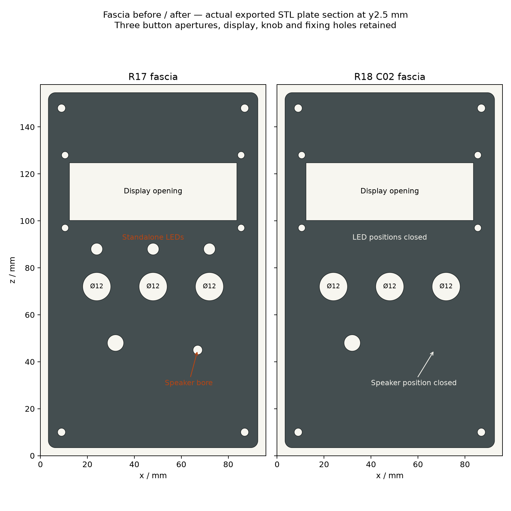
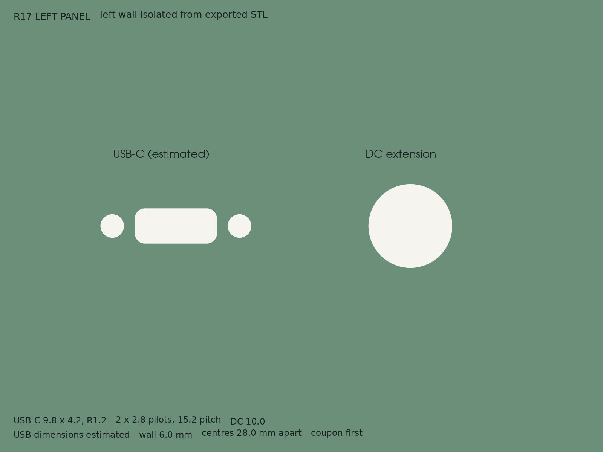
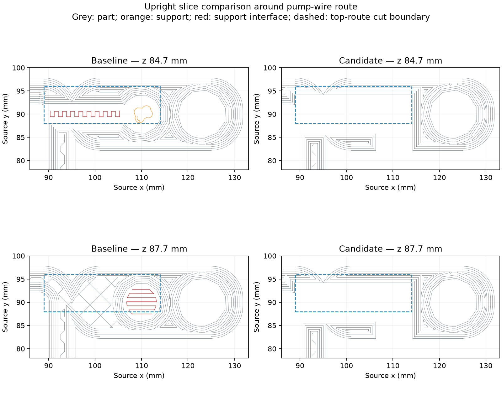

# Plant Station R18 - Design Review
PLANT-TR-001 / R18 / D03 / 11 October 2026
Issued for combined prototype review; physical acceptance open

Current mechanical configuration: R18 open-route tower and R18 fascia with auxiliary holes closed; retained R16 lid (R15 geometry) and R13 planter. Electrical reference remains frozen Uno UI v6 and the 27 September interface record. Arduino/relay registration is Reported; physical retention, wiring, wet and operational acceptance remain open.

## Current state and incorporated changes

Historical R17 assembled-STL review with the former enclosed route and R13 fascia apertures. It is retained for lineage and does not depict the combined R18 configuration or fitted hardware.

R18 combines the open pump-wire lay-in route and the fascia with three standalone LED holes plus the speaker hole closed. R15/R16 mounts/lid, R17 connector panel and frozen Uno UI v6 remain. Canonical tower/fascia exports are supplied for prototype review; physical and electrical acceptance remains open.

Historical R14 Uno supports reportedly split during screw insertion; R15 reinforced them. On 11 October Kevin reports the newest tower accepts both Arduino and relay perfectly but the terminated pump wire cannot pass the enclosed route. Preserve the fitted mounting geometry. No independent screw-retention, underside or powered-operation evidence closes the earlier actions.

This R18 D03 issue succeeds R17 D02 and integrates the two previously separate candidates. R17 originals remain historical. New CAD validation is evidence for the digital geometry; the reported board fit is partial first-article evidence and no R18 physical print or fit pass is asserted.

## Known constraints and configuration contract

| Interface | Current basis | Evidence status |
| --- | --- | --- |
| Body / fascia | R18 tower 207 x 100 x 158; fascia envelope 89.2 x 11 x 151.2 | Canonical combined prototype; physical dry fit open |
| Lid | 99 x 100 x 5.5; top z163.5 | Confirmed retained R15/R16 CAD |
| Uno | Four asymmetric R14 centres; y76 seat | Source-verified; newest board fit Reported; actual underside open |
| Bosses | 8.5 tip / 10 root / 19 projection; 2.8 x 11 pilot | Prototype; physical screw fit open |
| Relay | 50 x 26 PCB; 44.5 x 20.5 pitch | Seller/photo nominal; underside unknown |
| USB panel | 9.8 x 4.2 R1.2, 2.8 pilots at 15.2 pitch | Authorised best guesses |
| DC panel | Diameter 10; centre 28 from USB | User hole size; nut/grip unknown |
| Wet route | 4 mm floor; tube bore retained; crossover floor z77, 17 above rim | Open lay-in channel geometry checked; no accepted fill or retention |

Preserve the wet/dry partition, water bore, planter serviceability, asymmetric board registration, lid and retained control interfaces. User-edited print geometry was checked against the source before both candidates; no relevant source conflict was found. R18 changes no firmware or external supply architecture.

## Mount, lid and pump options

| Feature | Options and trade-off | Selected prototype / gate |
| --- | --- | --- |
| Uno mount | Retain reported-fitting reinforced bosses; inserts/captive nuts would need new fit/access evidence | R15 mount retained in R18; reported board fit only, screw/underside trial open |
| Lid | Thicker pocketed lid gives flush heads; unchanged thin roof preserves old shape but misses request | R15 5.5 thick, 6.6 x 2.5 pockets; head/engagement trial |
| Pump-wire route | Enlarged closed bore depends on terminals; open lay-in avoids bore threading; added cover needs parts/fixings | R18 open front/top route selected within authorised scope; dry fit/retention open |
| Relay placement | Vertical below Uno consumes nominal height; side wall conflicts with access; rear-wall horizontal gives service space | R16 horizontal, 12 mm above saddle and 13 below Uno; terminal/wire fit open |

Recommendation: retain the reported-fitting board mounts and combine the authorised lay-in route with the holes-only fascia change. Do not add a cover or alter button apertures. Validate actual wire bends, restraint, retained interfaces and print layers before accepting the prototype.

## R18 route and fascia configuration decision

Actual R17/R18 mesh comparison of the enclosed and open pump-wire routes.

Route cutters: front x106.5-114/y82-96/z52-129 and top crossover x89-114/y88-96/z77-159 mm. The crossing floor stays 17 mm above the 60 mm rim. Zero removed volume is recorded in the protected below-rim partition, sump floor, water-tube column, mounting region and rear-right lid fixing. Actual cable dimensions, bend radius, edge protection and retention remain Unknown.

Actual fascia comparison: three 5 mm standalone LED apertures and one 4 mm circular speaker aperture closed; three illuminated-button openings preserved.

| Fascia option | Benefit / cost | Disposition |
| --- | --- | --- |
| Fill only four obsolete apertures | Continuous 3 mm plate; retains fitted interfaces and rear geometry | Selected; replacement fascia, no new part |
| Remove rear collars and piezo ring as well | Could simplify rear geometry; expands scope and requires new interface review | Outside holes-only instruction |
| Leave old apertures | Retains old part; leaves unwanted openings | Does not meet current request |

Fascia fill is confined to y1-4 mm; 214.414 mm3 added and zero removed/outside the four patch regions. LED collars and piezo ring remain blind pockets. Three 12 mm button openings, LCD 71.4 x 24.6 mm aperture, 7 mm knob opening, four 3.4 mm fixings and display bosses remain. Integrated button LEDs retain D5/D6/D7 circuitry; D10 is unused.

## USB-C and barrel panel decision

Left-wall mesh detail; both openings are at z108.5.

| Option | Benefit | Trade-off |
| --- | --- | --- |
| Integral wall cuts (selected) | Matches requested fixed panel; no extra printed part | Estimated USB fit and 6 mm DC grip must pass coupon |
| Replaceable connector insert | Easier later adjustment to another USB/DC component | Adds fastening, seams and another controlled part |
| Retain broad cable opening | Accepts direct original cable access | Does not implement requested fixed sockets |

The user requested the fixed USB/DC panel and explicitly authorised best guesses with PCB-sized holes. Integral wall cuts are selected for this prototype. USB shell cut 9.8 x 4.2 R1.2; pilots 2.8 through at 15.2 pitch; DC diameter 10. USB y63, DC y35, common z108.5.

Estimated pilot-to-cut material is 1.3 mm. Image flange width 20.1 gives 12.95 mm to the DC cut; a guessed diameter-20 nut would leave 7.95 mm. These calculations depend on unmeasured component envelopes and do not establish fit or strength.

Recommendation: coupon both actual connectors together, including mating plugs, nut grip, screw tips and solder service. Keep the electrical pin/power interface open until characterised; no USB-C rating or source behaviour follows from the cut.

## Electrical and firmware configuration impact

R14 disabled-motor bench v2 and spare third switch are historical. Current source enables active-HIGH D9 relay requests and uses D2/D3/D4 switches; D5/D6/D7 red/yellow/green lamps. A4/A5 serve LCD; A0/A1 serve probe/pot; D10 is unused.

Dose requests are 1-4 s, knob sampled once. Yellow cycles pages/holds lamp test/cancels; STOP cancels and two-second hold clears session counters. Sensor is advisory; below 25% red blink, at/above green, raw <=20 fault. Software STOP and sensor fault do not provide hardware isolation.

UI v6 commands soil Status return at request end and I2C backlight off after 60 s idle, waking on buttons or >=8 ADC pot-count change. Serial OFF/ON and LCD status 0 were recorded on 27 September; earlier communication failures and visual/post-dose checks remain open.

Relay module/pump rating, current, supply behaviour and reset default-OFF are unmeasured. USB-C pins/configuration and barrel polarity/grip are unresolved. CAD provision does not accept a new power system. Keep a physical pump disconnect.

## Evidence and digital verification limits

| Evidence | Recorded result | Limit |
| --- | --- | --- |
| R15 independent checker | Six final meshes/sections passed | Fastener, pump and leak physical gates open |
| R16 independent checker | Three single-component meshes and relay sections passed | Nominal board envelope only; underside unmeasured |
| R17 STEP/readback | Both exports reopened as one valid solid | Builder process still exits 1 on shutdown |
| R17 independent STL | Two closed consistently wound meshes; all edges two-face; no degenerate faces | Full mesh self-intersection not checked |
| R17 sections | Six wall sections: USB 9.800 x 4.200, DC approx 9.998 centre section, pilots approx 2.800 | Tessellated mesh dimensions; not printed-hole readings |
| R17 change scope | 0 added/removed mm3 outside left-wall mask | Does not establish physical insertion or strength |
| UI v6 source and record | Current SHA-256 matches 27 September upload record | No new hardware run in this documentation task |

Combined nominal STEP geometry has zero intersection for all six main-part pairs and retains all eight board pilots. Actual solder, plugs, fasteners and service loops are not qualified. Original candidate CAD checks printed PASS then exited 1; scratch regeneration reproduced all three STL hashes, then both child processes returned 3221226356 (0xC0000374), wrapper exit 1. Combined STEP checks saved PASS then exited 1; mesh-only checking exits 0. A17-13 remains open; no full mesh self-intersection or physical acceptance is claimed.

| R18 evidence | Recorded result | Limit |
| --- | --- | --- |
| C01 route CAD/mesh | Valid single-solid STEP; closed wound single-component mesh; protected volumes unchanged | Actual cable, edge condition and retention unknown |
| C02 fascia CAD/sections | Valid single-solid STEP; 4 bores filled; retained sections/rear geometry coincide | New printed fascia dry fit open |
| 11 October user report | Arduino and relay fit perfectly in newest tower | Reported registration; print hash/screw/underside evidence absent |
| Candidate slice comparison | Support estimate 24.215 to 23.699 g; approx 2.13% less in copied upright profile | Comparison only; preset/ZFiller/filament warnings and anomalous time metadata |
| Process and combined checks | Eight board pilots unchanged; 6 part-pair intersections zero; scratch STL hashes identical | Original CAD exit 1; regeneration child exit 0xC0000374 after PASS; wrapper/STEP checks exit 1, mesh-only exit 0 |

Candidate comparison only: old enclosed route support/interface versus the opened route. These are not accepted R18 machine layers or printer instructions.

The selected route tunnel ceilings are removed, but the full tower is not established support-free. Slicer support mass is estimated commanded deposition, not measured material use. Missing-system-preset, ZFiller and bed-temperature/filament warnings, plus implausible timing metadata, prevent a print-ready claim. R17 projects remain historical; the combined R18 set requires its own complete layer review.

## Risks, unknowns and closure actions

| ID / type | Condition and effect | Mitigation / closure |
| --- | --- | --- |
| RI17-01 / Issue | USB cut/pitch and jack grip unmeasured; mismatch could require a body reprint | A17-01 coupon plus actual measurements |
| RI17-02 / Issue | R14 splitting history; newest Uno board fit reported, screw retention/strength still open | A17-02 representative screw/material evidence; inspect root/tip |
| RI17-03 / Risk | Relay solder/terminals and fascia services may collide | A17-05/06 full assembled dry fit and removal trial |
| RI17-04 / Issue | LCD intermittent communication faults; screen may fail under load | A17-09 supply/I2C/suppression investigation and repeat observations |
| RI17-05 / Risk | Relay closure through boot/reset or welded contacts may leave pump running | A17-08 measured default-OFF; physical disconnect |
| RI17-06 / Issue | Fill/leak/material limits unknown; ingress into electronics possible | A17-11/12 material qualification and controlled leak/drain-back/splash evidence |
| RI17-07 / Issue | USB/barrel wiring and rating unresolved | A17-07 identified source diagram, continuity and load evidence |
| RI17-08 / Issue | CAD exit code 1 prevents a clean-build claim | A17-13 isolate shutdown cause or retain explicit exception |

Risk ratings remain qualitative; no rating matrix was supplied. All owners: Unassigned; target dates: Not set. A17 actions remain open. New risks are wire abrasion/lift at the open channel and defects or trapped services in the replacement fascia; close through A18-01 to A18-04 with actual build evidence.

## Acceptance recommendation and next actions

1. Measure and lay in the actual terminated pump lead; check smooth bend, edge condition and retention. 2. Inspect the replacement fascia and dry-fit the existing buttons/display/knob/fixings. 3. Review complete R18 layers/material/orientation, then record the matching printed article and combined service/removal trial. 4. Carry forward all A17 connector, screw, electrical, default-OFF, LCD, leak/fill and dose gates before supervised wet acceptance.

PLANT-TS-001 R18 D03 retains A17-01 through A17-13 and adds A18-01 through A18-04. Reported board fit does not close any complete action. Current disposition: combined prototype review; digital checks recorded; manufacturing, physical and electrical acceptance open.

References: cumulative change matrix; preserved R17 D02 sources; R18 C01/C02 geometry, independent assurance, process logs and previews; reported_first_article.json; frozen Uno UI v6 and 27 September interface/upload evidence. No missing earlier manual issues are created.
